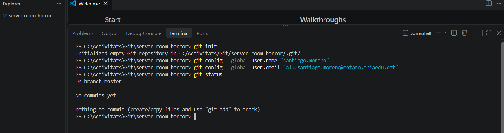
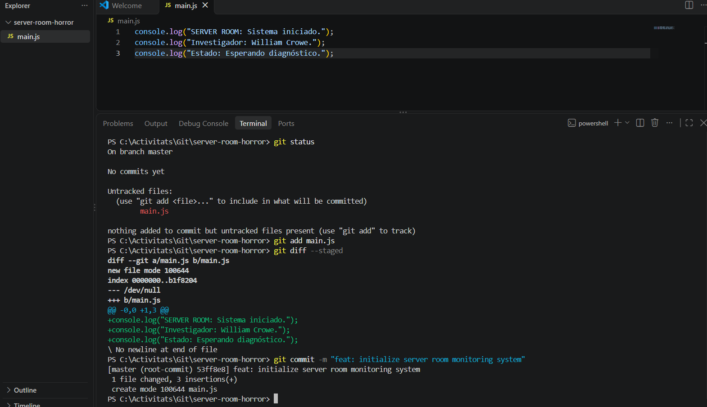
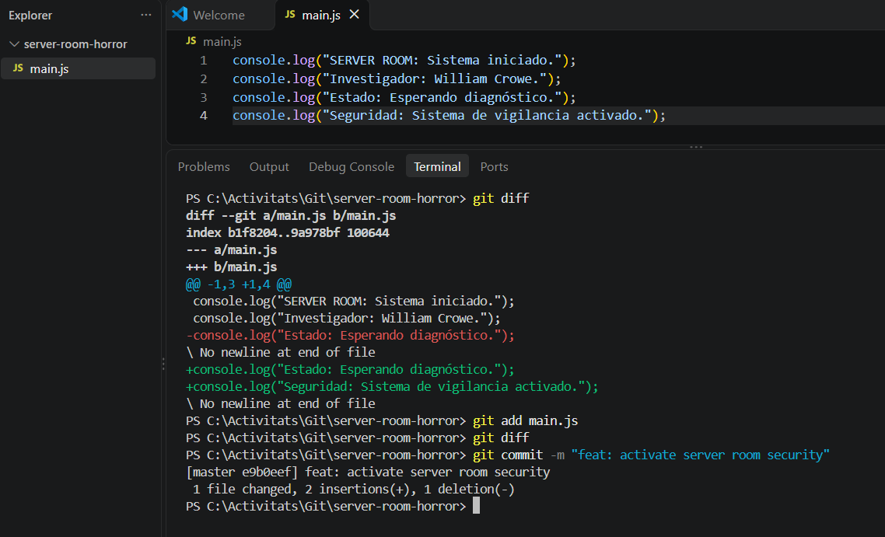
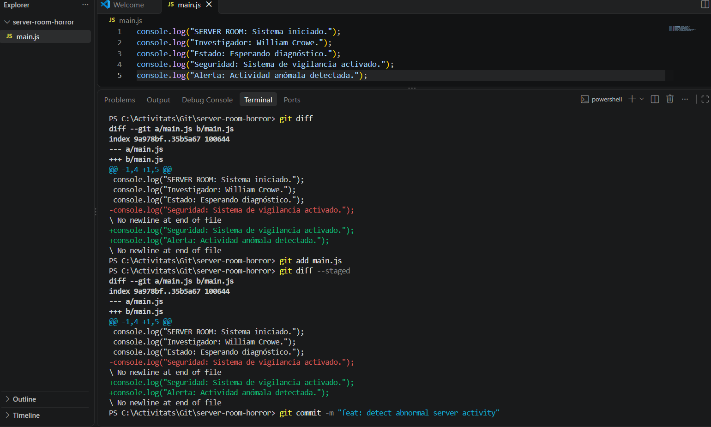
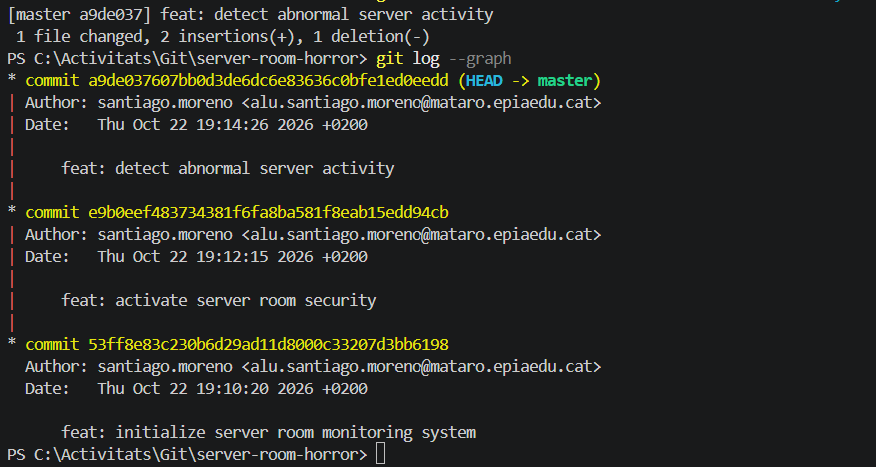

# Bloc 1: Invocació del Repositori i Línia Base

## Acció 3.1 — Creació del repositori

S'ha creat el repositori local server-room-horror per iniciar
la reconstrucció del sistema de la sala de servidors.

```bash
git init server-room-horror
cd server-room-horror
git status
```

## Acció 3.2 — Configuració de Git

S'ha configurat la identitat de l'investigador i l'editor
de text que utilitzarà Git.

```bash
git config --global user.name "santiago.moreno"
git config --global user.email "alu.santiago.moreno@mataro.epiaedu.cat"
```



## Acció 3.3 — Primer commit

S'ha creat main.js amb els missatges inicials del sistema
i s'ha registrat la primera versió.

```bash
git add main.js
git diff --staged
git commit -m "feat: initialize server room monitoring system"
```



## Acció 3.4 — Segon i tercer commit

El segon commit activa la seguretat. El tercer registra
la detecció d'una activitat anòmala.

```bash
git add main.js
git commit -m "feat: activate server room security"
```


```bash
git add main.js
git commit -m "feat: detect abnormal server activity"
```


## Acció 3.5 — Historial

S'ha consultat l'historial gràfic per comprovar les versions
inicials del repositori.

```bash
git log --graph
```


