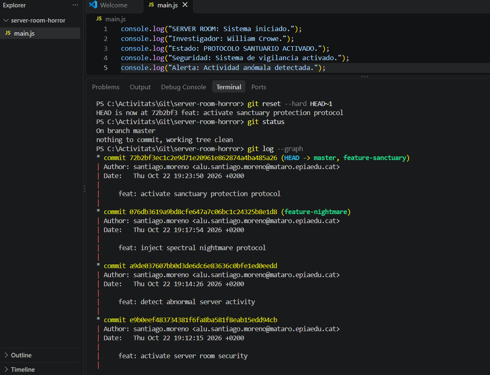
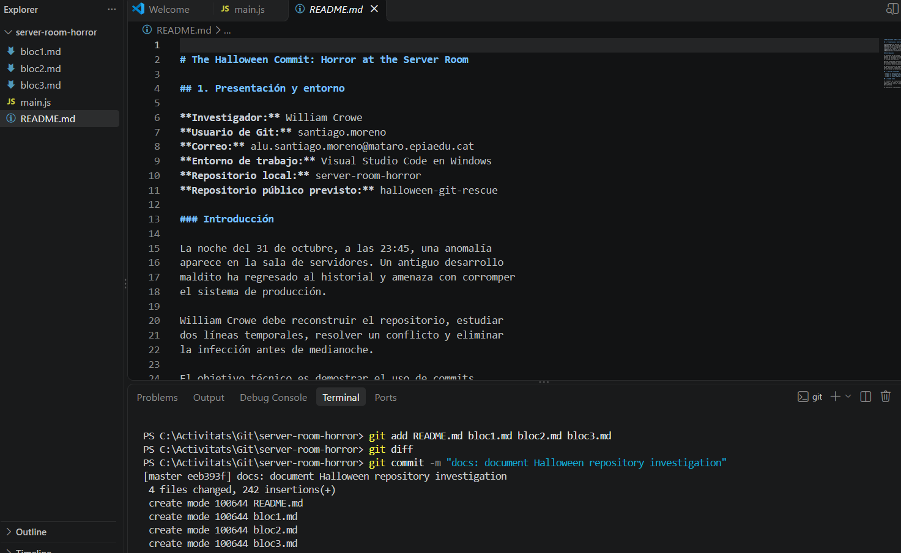
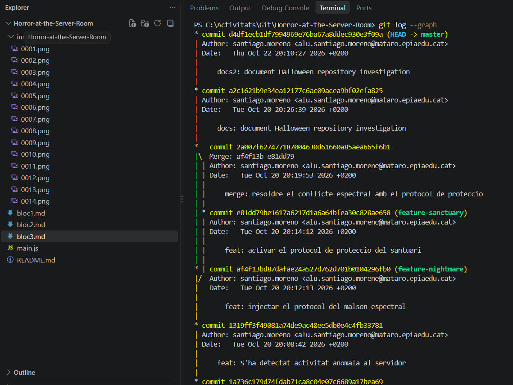
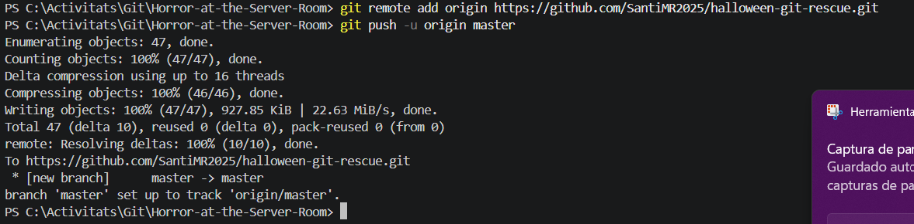

# Bloc 3: Viatge Temporal, Exorcisme del Codi i Publicació Remota

## Acció 3.11 — Commit infectat

S'ha afegit un missatge d'error per representar l'última
infecció del sistema.

```bash
git add main.js
git commit -m "feat: unhandled spectral exception"
```


## Acció 3.12 — Inspecció de diferències

S'ha comparat el commit infectat amb el commit anterior
per identificar el canvi introduït.

```bash
git diff HEAD~1 HEAD
```



## Acció 3.13 — Exorcisme

S'ha restaurat el commit anterior i s'ha eliminat la
infecció de l'estat actual de la branca principal.

```bash
git reset --hard HEAD~1
git status
```



## Acció 3.14 — Historial final

S'ha consultat l'historial gràfic per verificar les
branques, la fusió i la restauració de l'estat segur.

```bash
git log --graph
```



## Acció 3.15 — Publicació remota

S'ha creat el repositori públic halloween-git-rescue
a GitHub.

**URL del repositori:** [Afegir l'enllaç real]

La publicació completa del repositori, incloent-hi
les branques i l'historial, queda pendent de completar
amb el procediment de publicació explicat a classe.

**Captura:** [Afegir captura del repositori públic]

